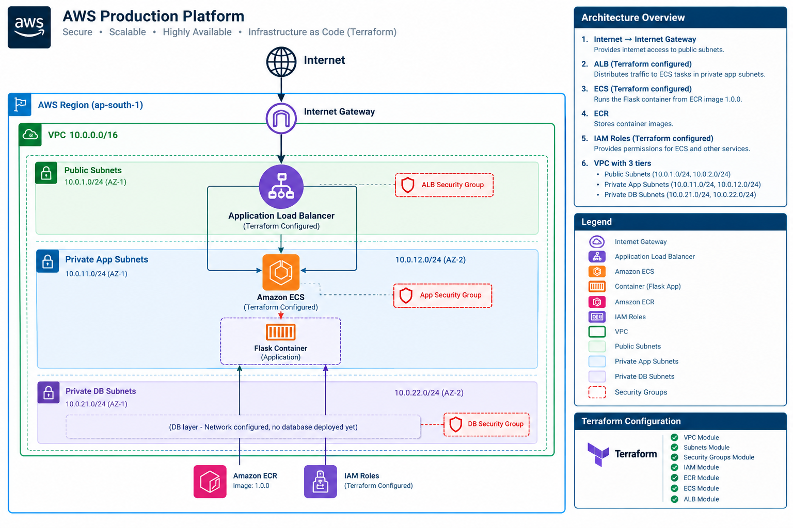

# AWS Production Platform

An AWS infrastructure project built using **Terraform, Docker, Python, Flask, and AWS services**.

## Project Overview

This project demonstrates practical Infrastructure as Code (IaC), AWS networking, IAM, containerization, Amazon ECR, and modular Terraform configuration.

The infrastructure is designed with public and private subnet separation across two Availability Zones.

## Architecture



The architecture includes:

- AWS VPC with CIDR `10.0.0.0/16`
- Public subnets across two Availability Zones
- Private application subnets across two Availability Zones
- Private database subnet configuration across two Availability Zones
- Internet Gateway
- Security Groups for ALB, application, and database access
- IAM roles for ECS
- Amazon ECR container image
- Terraform configuration for ECS and Application Load Balancer

> **Note:** ECS and Application Load Balancer resources are configured in Terraform but have not been deployed.

## Technologies Used

- AWS VPC
- Public and private subnets
- AWS Security Groups
- AWS IAM
- Amazon ECR
- Docker
- Python
- Flask
- Terraform

## Current Implementation

- Created a VPC with public, private application, and private database subnet configurations.
- Created public and private route configurations.
- Created security groups for load balancer, application, and database access.
- Created IAM roles for ECS task execution and application tasks.
- Created an Amazon ECR repository with image scanning, immutable tags, and a lifecycle policy.
- Built and tested a Flask application locally.
- Built and tested the Docker container locally.
- Verified application endpoints on port `8000`.
- Pushed Docker image version `1.0.0` to Amazon ECR.
- Created modular Terraform configuration for ECS and Application Load Balancer.
- Validated the Terraform configuration successfully.

## Application

The project contains a simple Flask application packaged as a Docker container.

### Application Endpoints

| Endpoint | Purpose |
|---|---|
| `/` | Application status |
| `/health` | Health check |
| `/version` | Application version |

The Flask application listens on port `8000`.

## Terraform Structure

```text
terraform/
├── environments/
│   └── dev/
│       ├── main.tf
│       ├── outputs.tf
│       ├── provider.tf
│       └── versions.tf
│
└── modules/
    ├── vpc/
    ├── security-groups/
    ├── iam/
    ├── ecr/
    ├── ecs/
    └── alb/
```

The Terraform configuration is organized into reusable modules for networking, security, IAM, container registry, ECS, and load balancing.

## Project Structure

```text
aws-production-platform/
│
├── application/
│   ├── app.py
│   ├── requirements.txt
│   ├── Dockerfile
│   └── .dockerignore
│
├── architecture/
│   ├── aws-architecture.mmd
│   └── aws-architecture.png
│
├── docs/
│   ├── deployment.md
│   └── cleanup.md
│
├── terraform/
│   ├── environments/
│   │   └── dev/
│   └── modules/
│       ├── vpc/
│       ├── security-groups/
│       ├── iam/
│       ├── ecr/
│       ├── ecs/
│       └── alb/
│
├── .gitignore
└── README.md
```

## Validation

The Terraform configuration was validated successfully.

The Flask application was tested locally, the Docker container was tested locally, and Docker image version `1.0.0` was successfully pushed to Amazon ECR.

## Deployment Status

### Applied through Terraform

- VPC
- Public and private subnet configuration
- Route tables and associations
- Security Groups
- IAM roles
- Amazon ECR repository

### Configured but Not Deployed

- Amazon ECS
- Application Load Balancer

This README reflects the actual implementation status of the project.

## Cleanup

AWS resources created for this project should be reviewed and destroyed when no longer required to avoid ongoing AWS charges.

See [`docs/cleanup.md`](./docs/cleanup.md) for the cleanup procedure.